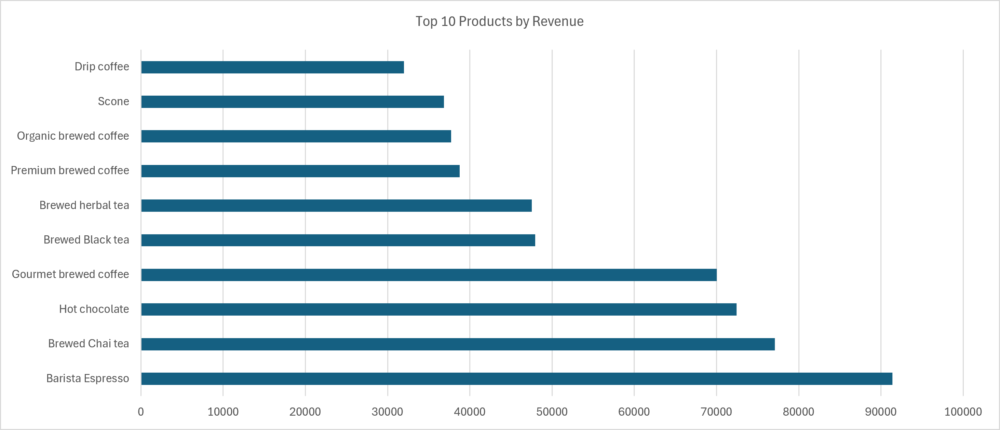
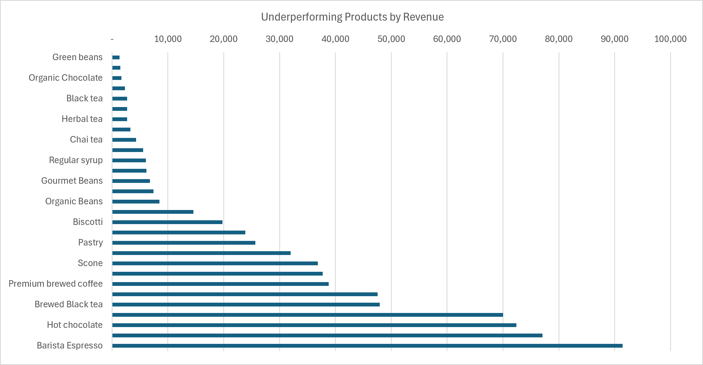
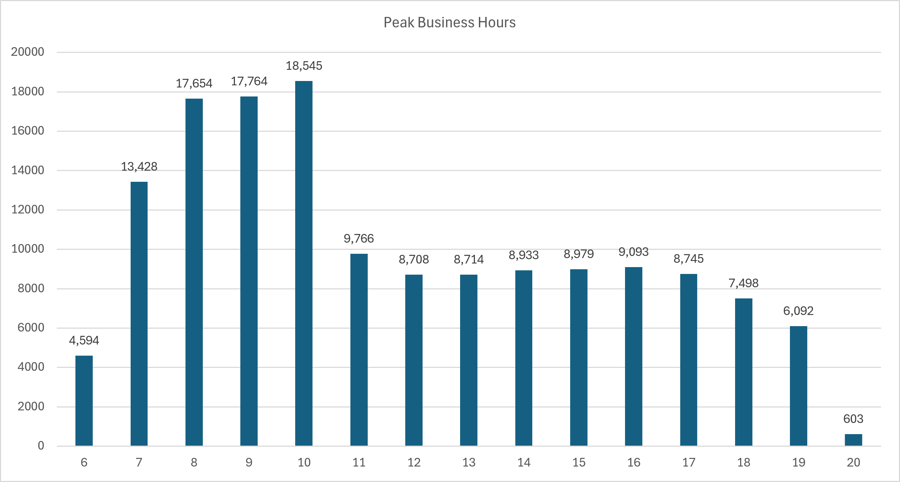

# Coffee Shop Business Intelligence Analysis
## Project Overview
This project analyzes coffee shop transaction data using MySQL to identify store performance, revenue drivers, customer purchasing behavior, and underperforming products.

The objective is to generate business insights and support data-driven decision-making through SQL-based analysis.

## Dataset Information
|Item|	Value|
|---------------|-----------:|
|Total Transactions|	149,116|
|Number of Stores|	3|
|Database|	MySQL|
|Analysis Tool	|MySQL Workbench|

### Store Locations
- Astoria
- Hell's Kitchen
- Lower Manhattan

## Analysis 1: Store Performance Analysis
Business Question:

Which store recorded the highest number of transactions?

## Insight

Hell's Kitchen recorded the highest number of transactions, followed closely by Astoria. Lower Manhattan had the lowest transaction count.

## Analysis 2: Store Sales Quantity Analysis
Business Question:

Which store sold the highest number of products?

## Insight

Lower Manhattan recorded the highest sales volume, although the difference among the three stores was relatively small.

## Analysis 3: Store Revenue Analysis
Business Question:

Which store generated the highest revenue?

## Insight

Hell's Kitchen generated the highest revenue among the three locations. Revenue performance differed from sales volume, suggesting that product mix and pricing influenced overall revenue.

## Analysis 4: Product Category Revenue Analysis
Business Question:

Which product category generated the highest revenue?

## Insight

Coffee was the highest revenue-generating category, followed by Tea. Beverage products contributed the majority of total revenue and served as the primary business revenue drivers.

## Analysis 5: Top Products by Revenue

Business Question:

Which products generated the highest revenue?

## Insight

Barista Espresso generated the highest revenue among all products, exceeding $91,000 in sales. Coffee and tea beverages dominated the top revenue rankings, indicating strong customer demand for beverage products.

## Analysis 6: Underperforming Products by Revenue

Business Question:

Which products generated the lowest revenue?

## Insight

Green Beans generated the lowest revenue among all product types. Several specialty products and retail items generated substantially lower revenue than beverage products, suggesting lower customer demand.

## Analysis 7: Peak Business Hours Analysis

Business Question:

When are the busiest business hours?

## Insight

Transaction volume increased significantly after 7 AM and peaked between 9 AM and 10 AM.

This finding is consistent with customer morning purchasing behavior and highlights the importance of staffing and inventory planning during peak hours.

## Analysis 8: Store Preference Analysis
Business Question:

Do customer preferences vary by store location?

|Store Location|	Top Revenue Product|Revenue|
|----------|-------|----------:|
|Hell's Kitchen|	Barista Espresso|32,420.20|
|Lower Manhattan|	Barista Espresso|31,051.00|
|Astoria|	Barista Espresso|27,935.00|

## Insight

Barista Espresso was the highest revenue-generating product across all three store locations. Customer preferences appeared to be generally consistent regardless of store location.

## Key Findings
- Hell's Kitchen generated the highest overall revenue.
- Coffee was the highest revenue-generating product category.
- Barista Espresso was the best-performing product across all three stores.
- Customer traffic peaked between 7 AM and 10 AM.
- Several specialty products generated significantly lower revenue than core beverage products.
- Customer purchasing preferences were generally consistent across locations.
## Business Recommendations
- Continue promoting high-performing coffee and tea products.
- Review low-performing products for potential menu optimization.
- Allocate staffing resources during peak morning hours.
- Maintain strong inventory support for espresso-based beverages.
- Consider targeted promotions for underperforming specialty products.
## Skills Demonstrated
- SQL
- MySQL
- Data Analysis
- Business Intelligence
- Data Exploration
- GROUP BY
- COUNT()
- SUM()
- ROUND()
- ORDER BY
- Business Insight Generation